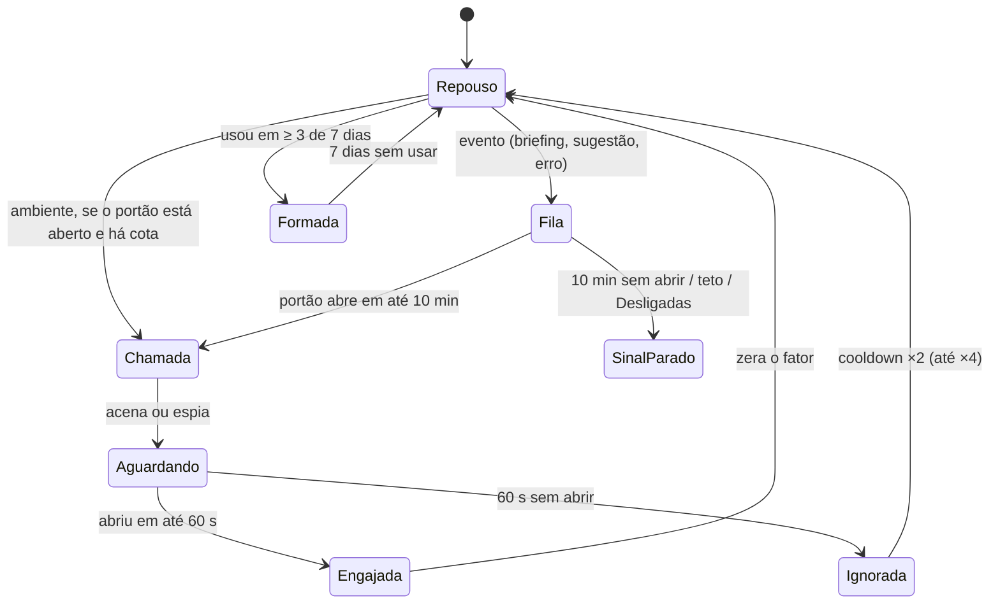

# Botão do Copiloto: varredura nas letras e mascote

> **DECISÃO 16/10/2026: direção C (Personagem).** O Rogério escolheu C em vez da B recomendada ("fica mais viva,
> dá um ar de mais diversidade") e quer o personagem como parte do sistema (carregamento longo, "pensando",
> vazios, recibos, onboarding), de forma estratégica. Os defeitos da C nesta proposta (braços a 24 px, Rive)
> viram requisitos: rig com nível de detalhe e tecnologia por spike medido. Este documento fica como histórico
> da proposta; a regra vigente está em [`ADR-006`](../decisions/ADR-006-mascote-personagem-tecnologia-e-politicas.md)
> e [`MASCOTE_ANIMACOES.md`](../features/MASCOTE_ANIMACOES.md) (fase F76).
>
> Demo: [`copilot-botao-animacao.html`](copilot-botao-animacao.html). Abra no navegador. O topo troca tema, marca, modo e direção, e `?solo=<seção>&theme=light&tenant=maian&dir=A` isola uma seção.
> Capturas: [`copilot-botao-animacao/`](copilot-botao-animacao/) em 1440 e 375, escuro e claro, com um quadro por direção e uma tira de quadros por estado.
> Base: maquete aprovada [`copilot-integracoes.html`](copilot-integracoes.html) (glifo de órbita, alça de borda) e tokens do DS 3.0. Status: proposta para decisão, sem código de produto.

## 1. Como se chama

| O que você descreveu | Termo (EN) | Termo (PT) | Como é feito |
|---|---|---|---|
| Gradiente que passa “dentro das letras” de vez em quando | **Animated gradient text**: *shimmer text* quando é uma faixa de luz, *aurora text* quando são várias cores fluindo. O nosso é um *sheen sweep* de uma faixa. | Texto com gradiente animado (varredura) | `background-clip: text` recorta o gradiente pela forma das letras. A posição da faixa é uma propriedade registrada com `@property` (CSS Houdini, Properties and Values), por isso o navegador interpola. |
| Bonequinho que acena para chamar atenção | **Character animation** com **attention seeker** (é o nome da categoria no Animate.css) ou **nudge** (em UX) | Animação de personagem; chamariz ou “cutucada” | Keyframes por estado, com os princípios clássicos: **anticipation** (antecipação), **squash & stretch** (comprimir e esticar), **follow-through** (a antena atrasa o aceno) |
| Ele pisca parado | **Idle animation** | Animação de repouso | Piscar de 140 ms a cada 4–9 s, só quando visível |
| Ele tem “humores” e troca entre eles | **State machine** (é o nome que a Rive usa) | Máquina de estados | Um atributo `data-state` mais um diretor de atenção (§3) |
| Robô em pixel (direção A) | **Stepped animation** / sprite a 12 fps | Animação em passos | `steps(1, end)` ou o motor do pixel-anima |
| Rig com “ossos” (só na direção C, se for para Rive) | **Skeletal animation** | Animação por esqueleto | Ferramenta Rive ou Spine |
| Pequenas respostas a hover e clique | **Micro-interactions** | Microinterações | Hover, pressionado e foco (§2) |

**Sobre o “groqbot”:** não encontrei nenhum mascote público com esse nome, e não vou inventar uma referência. A proposta trata o pedido como estilo: um mascote pequeno, simpático e com ciclo de vida. Na demo há três direções, e a pergunta 1 é qual delas chega mais perto do que você imaginou.

## 2. Especificação

**Botões.** O principal fica na **sidebar** (212 × 52 px): mascote de 24 px, “Copiloto” e uma **linha de status** que diz o motivo (“3 itens no briefing”, “Omie com falha”). O **TopBar** é o atalho compacto (36 px). Com a barra recolhida, o botão vira 44 × 44 só com o mascote. No **celular** é 44 × 44 no TopBar. **Um ator por vez:** quem chama é a sidebar; o TopBar só ganha vida quando a sidebar não está visível.

| Estado | Valor |
|---|---|
| Hover | 200 ms `--ease-saida`, sobe para `--surface-2`, e uma varredura por entrada do cursor (no máximo 1 a cada 2 s). O mascote olha para cima. |
| Foco | Anel de 2 px com offset de 2 px em `--focus` (≥ 3:1). O teclado não dispara animação. |
| Pressionado | `scale(.97)` em 120 ms |
| Aberto | Barra de 2 px em `--m-accent`, o mascote olha para o painel, o atalho vira Esc e `aria-expanded="true"` |
| Pendência | **O satélite do glifo fica aceso** (`--m-accent`, ou `--warn` em erro). Não há ponto separado: o glifo da marca é o sinal. |

**Varredura.** São 900 ms em `linear`: é luz que passa, com velocidade constante no trecho visível. A faixa ocupa 56% da palavra, a 105°, interpolada em oklab. Fora do gatilho o texto é sólido. **Piso de contraste:** cada parada (`--cp-ink`, `--cp-ink-a`, `--cp-ink-b`) precisa de ≥ 4,5:1 sobre `--surface` e `--surface-2`. A luminância é monotônica entre as paradas, então o piso das paradas é o piso do texto. Medido na demo: Leadium 13,9 (escuro) e 6,2 (claro); Odonto 7,6 e 6,0; Maian 8,3 e 4,7. O laranja #EE7623 dá 2,9:1 no branco, então a letra usa #B4530F e o mascote #D4610F (≥ 3,4:1).

**Mascote: estados** (todos ≤ 900 ms fora de loop, cânone §4)

| Estado | Duração e curva | Gatilho | Nunca quando |
|---|---|---|---|
| Repouso | parado: não respira nem flutua | padrão | — |
| Pisca | 140 ms `--ease-mover` | 4–9 s, só na tela | aba oculta, Desligadas |
| Acena | 860 ms; antecipação de +18°, dois ciclos, a mão sai 1,5 px da órbita | briefing do dia; chamada ambiente | digitando, foco em campo, modal, arrasto |
| Brinca | 700 ms, comprime e estica, salto de 3,6 px | primeiro uso, marcos | mais de 1×/semana |
| Pensando | 1,6 s `linear` ∞ (único loop) | o Copiloto está trabalhando | sem trabalho real |
| Comemorou | 900 ms | “Ação concluída” (junto do Desfazer) | ação falhou |
| Dormindo | pose de 320 ms | fora do horário, aba parada 30 min | — |
| Confuso | 900 ms e fica na pose | erro de integração | erro que a pessoa não resolve |
| Espiar da borda | entra em 320 ms, sai em 240 ms | sugestão pendente | Copiloto aberto |

**Tokens novos** (todos em `@hm/design-tokens`, por tema e por marca): `--cp-ink`, `--cp-ink-a`, `--cp-ink-b`, `--m-ink`, `--m-fill`, `--m-accent`, `--m-visor`, `--m-eye`, `--m-cut`. Mais a flag de marca **`copilot.mascot: on | off`**: no Odonto é `off`, com glifo parado e varredura violeta só por evento, porque a marca proíbe mascote, rosto e faísca.

**Modos** (Configurações do Copiloto → “Animações do Copiloto”):
- **Vivas** é o padrão.
- **Discretas**: só o glifo, com varredura e uma volta do glifo apenas por evento. É o padrão quando o sistema pede `prefers-reduced-motion`.
- **Desligadas**: nada se move. Fica o satélite aceso e o texto de status.

Com movimento reduzido, cada estado congela no seu quadro-pose e só esmaece em 160 ms, e a varredura vira troca de cor em 200 ms. Tudo é `aria-hidden`. O anúncio vai para uma região `aria-live="polite"` (“briefing do dia pronto, 3 itens”). Nada pisca acima de 3 Hz: o pulso mais rápido é de 0,75 Hz.

## 3. Orçamento de atenção

- **Portões (todos precisam abrir):** aba visível e botão na tela; pessoa parada há ≥ 20 s e sem tecla há ≥ 4 s; sem foco em campo, modal, arrasto ou ponteiro pressionado; Copiloto fechado; fora dos primeiros 3 min da sessão.
- **Cotas:** chamada ambiente 2/dia com cooldown de 12 min. Evento com cooldown de 3 min: briefing 1/dia, sugestão 1 a cada 2 h, erro 1 por integração por dia. **Teto somado de 4 chamadas/dia.** Varredura ambiente 10/dia, com 6 min entre elas.
- **Aprende:** ignorar = 60 s sem abrir depois de um aceno. Aviso de erro não conta, porque é informação, não convite. Com 2 ignoradas seguidas, o cooldown dobra (até ×4). Com 4 em 7 dias, fica **silenciada por 7 dias**: sem chamada ambiente, e evento vira varredura com satélite aceso. **Formada** (usou o Copiloto em ≥ 3 dos últimos 7 dias): não é mais chamada, e o evento vira só varredura.
- “Ação concluída” é resposta a quem agiu e não gasta cota. Prioridade da fila: erro > briefing > sugestão.

## 4. Tecnologia e peso

| Opção | Peso | Estados | A11y e controle | Veredito |
|---|---|---|---|---|
| **CSS + SVG inline** | B medido: **≈ 3 KB gz** (SVG 0,4 + CSS 2,7) | `data-state` + keyframes; congelável pela Web Animations API | `aria-hidden`, reduced motion e tema por token, nativos | **Recomendado** |
| Canvas + sprite (pixel-anima) | motor ≈ 12 KB gz + sprite | ótimo para 12 fps | precisa de pôster e de pausa própria | Só se A |
| Rive | runtime WASM, pesado para o orçamento (medir a versão) | máquina de estados nativa, a melhor para C | cor por token exige inputs no arquivo | Só se C, e lazy |
| Lottie | player na casa de dezenas de KB gz | fraco em estados (timeline) | cor travada no JSON | Não |

**Orçamento:** a função inteira (mascote, varredura e diretor de atenção) fica em **≤ 8 KB gz**, com teto duro de 30 KB para qualquer direção. Componente `<CopilotMascot state>` em `packages/ui`, diretor de atenção como hook no `apps/web`, sem dependência nova. Só `transform` e `opacity` (e a variável registrada da varredura). Pausa com `visibilitychange` e `IntersectionObserver`. Zero layout shift: a pílula do celular é camada com `clip-path`.

**Recomendação: B · Órbita (28/30).** É o glifo aprovado ganhando rosto, então o mascote é a marca viva e não um personagem colado ao lado. Lê bem a 18–24 px, troca de cor por marca sem retrabalho, cabe em 3 KB e não pede runtime. A (21/30) tem charme a 96 px, mas a 24 px puxa para jogo. C (17/30) é a mais expressiva, mas os braços viram ruído a 24 px e ela pede Rive.

## 5. Onde mais aplicar

| Lugar | Ganho de UX | Custo | Risco | Veredito |
|---|---|---|---|---|
| Indicador “pensando” do Copiloto | Alto: estado vivo no lugar da linha de scan, mais texto shimmer “Lendo o pipeline…” | Baixo | Nenhum | **Vale** |
| Recibo de ação com Desfazer | Alto: “comemorou” confirma sem toast extra | Baixo | Comemorar uma ação errada; só depois de sucesso | **Vale** |
| Cabeçalho do Briefing | Médio: uma varredura no título ao abrir | Baixo | Nenhum | **Vale** |
| Onboarding / primeiro uso | Alto: apresenta o Copiloto e o gesto da borda | Médio | Repetir; é uma vez só | **Vale** |
| Estado vazio (Copiloto, Atividade) | Médio: pose parada “dormindo” e uma frase | Baixo | Loop em vazio | **Vale, sem loop** |
| Card “Atenção” da Loja de Integrações | Médio: pose “confuso” parada | Baixo | Nenhum | **Vale, estático** |
| Assistente de mapeamento do ERP | Médio: “pensando” enquanto lê o exemplo | Baixo | Infantilizar tela séria; nada de “confuso” | **Vale, só pensando** |
| ⌘K “Perguntar ao Copiloto” | Médio: uma varredura quando a busca vira pergunta | Baixo | Nenhum | **Vale** |
| Selo “sugerido pelo Copiloto” no Pipeline | Autoria clara | Baixo | Animar em lista vira circo | **Só glifo estático** |
| Notificações e toasts | — | — | Vários animando juntos | **Não**: glifo estático |
| Loading e splash | — | — | Atrasa a percepção (o cânone pede skeleton) | **Não** |
| Ícone do PWA e badge | — | — | O ícone é da marca Leadium, não do Copiloto | **Não** |
| Inbox e mensagens a clientes | — | — | Confunde com o agente de atendimento e vaza para o cliente final | **Nunca** |
| KPIs e números | — | — | Shimmer em número atrapalha a leitura | **Nunca** |

## 6. O que ficou de fora ou não foi testado

- A demo **não mede** INP nem quadros longos (Long Animation Frames) com CPU 4× mais lenta; isso fica para o slot de implementação.
- Os pesos de Rive e Lottie não foram medidos (marcados “medir”).
- O simulador sorteia a atividade com semente fixa. Os números do orçamento são hipótese a validar por telemetria (taxa de abertura por chamada, ignoradas, dias até ficar “formada”).
- Os testes rodaram em Chromium. Safari e Firefox não foram testados: `@property` só chegou ao Firefox na versão 128, e sem ele a varredura simplesmente não roda (o texto fica sólido).

## 7. Perguntas para o Rogério

1. **Direção do mascote:** A (pixel), B (órbita) ou C (personagem)? Qual chega mais perto do “groqbot” que você imaginou? Se nenhuma, mande uma referência visual.
2. **Nome próprio do assistente.** O mascote depende disso: “Copiloto” é genérico, e um nome da marca muda o rosto, a voz e até se ele deve ter rosto.
3. **Frequência:** o padrão proposto é teto de 4 chamadas/dia e 2 ambientes. Quer mais agressivo nos primeiros 7 dias (onboarding) e mais quieto depois?
4. **Padrão por papel:** atendimento começa em Discretas, e gestão em Vivas?
5. **Maian:** confirma o mascote ligado para as vendedoras, ou só o glifo laranja?
6. **Telemetria:** podemos medir chamada → abertura em 60 s para calibrar o orçamento (sem conteúdo, só eventos)?
